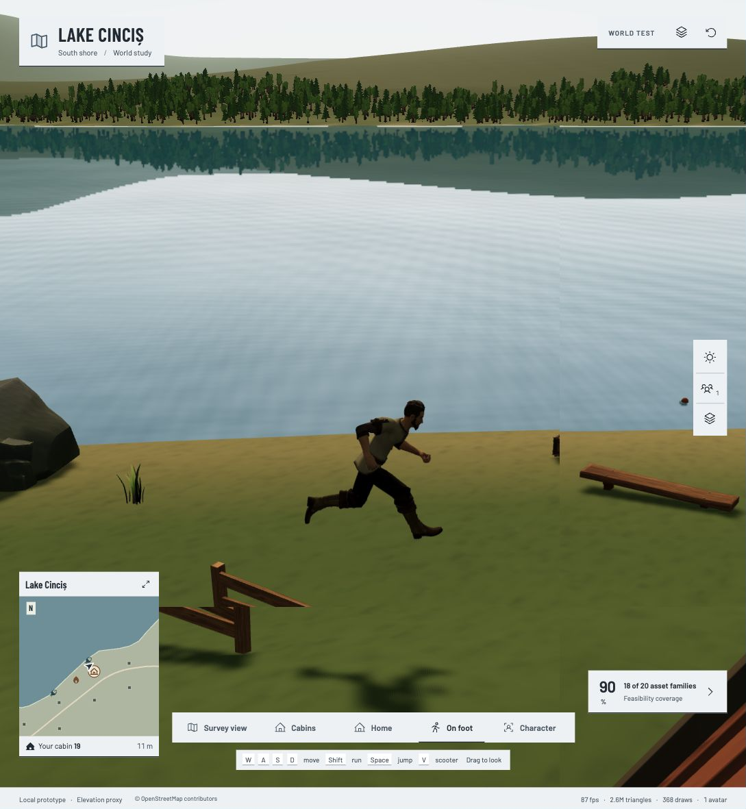
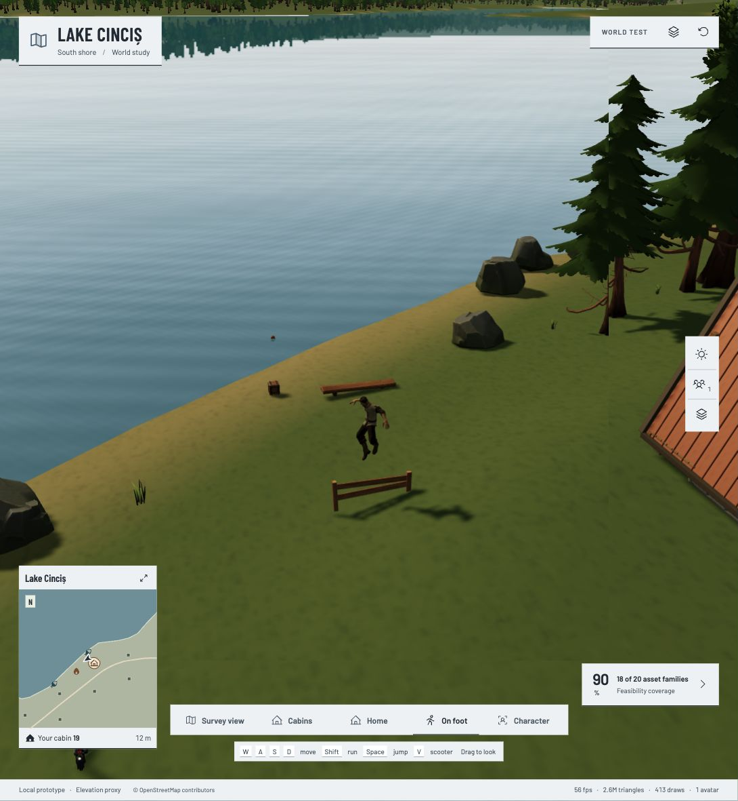

# Running and walking jumps

Running jumps use one extended stride from the existing character’s `Run` clip. The three in-place segments share exact boundary poses: push-off, a held front-leg reach with a trailing rear leg, and a short landing that resumes the run at the matching stride phase. The physics arc and speed remain unchanged. Walking jumps retain `Jump_Start`, `Jump_Loop` and `Jump_Land`.

The style is selected from horizontal speed at takeoff and retained through landing. Releasing Shift or slowing down in the air does not switch poses. Shift is held to run, matching the game’s controls. A consistent airborne sole offset and matched fade durations remove the old height pop and uneven phase blends.

## Multiplayer integration

Local motion sampling remains at 7 Hz. `jumpPhase`, `animation`, `vehicle`, `speed` and feet/root position retain the current wire contract. No new protocol field is needed: remote avatars infer a running jump from the `Jump_Run*` animation names and load the same derived clips. The local diagnostic includes `jumpStyle`; it is not sent over the wire. Scooter and activity hooks remain in place.

## Validation and provenance

The derived clips reuse the already-shipped `Lakeside_Man.glb` animation; they introduce no new external asset or download. The source animation is never mutated. Tests sample the actual retained rig to verify the forward/trailing foot separation, continuous segment boundaries, unchanged world root, takeoff-style lock, ledge transitions, and pose-packet compatibility.

The screenshots and JSON beside this file were captured in the legacy shared preview on 28 October 2026 before the GitHub migration. They demonstrate the completed local run/walk behavior; they are not a claim of production or two-client verification of this branch. The run capture records `Jump_RunAir`; the walk capture records `Jump_Loop`.

Migration validation passed: 93 frontend tests, 9 protocol tests, the server type check and the production build. The existing bundle-size advisory remains.

The dedicated worktree validates with `npm test`, `npm run build`, `npm run server:check` and `npm run test:protocol`. It does not start a local server or write the legacy preview’s `dist`. Integration into main and a production two-player visual check remain with the release owner.
