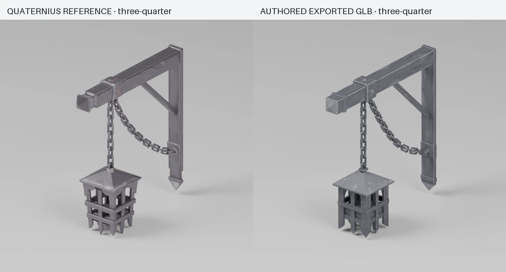
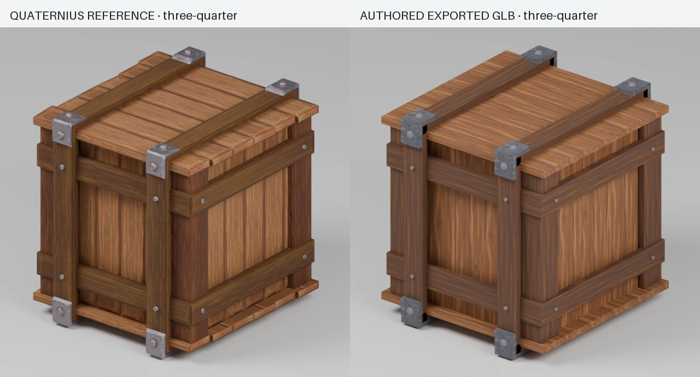

# Reference-guided 3D asset skill: two-prop experiment

30 October 2026. This isolated experiment is based on release commit `9abeec34e3ccbec2c797e5af4449afb51d9af8a9`. Production assets, gameplay code, shared ownership and the preview server were not changed.

## Outcome

The repository now contains `.agents/skills/la-baraj-3d-assets/SKILL.md`, reusable measurement/construction/export/QA tools, and two independently authored Blender reconstructions. Both final GLBs pass the recorded technical budgets. They are close visual prototypes with remaining differences, not proven 1:1 replacements.

The reference files are the project's retained CC0 Quaternius Fantasy Props MegaKit exports: `Lantern_Wall.glb` and `Crate_Wooden.glb`. Their original notice is in `references/LICENSE.txt`. The build script does not import their geometry or reuse their texture maps. It authors geometry from rendered views and aggregate dimensions; the new surface atlas was generated with the built-in ImageGen tool. Full provenance is in `provenance.json`.

## Measured final results

| Metric                          | Lantern reference | Lantern reconstruction | Crate reference | Crate reconstruction |
| ------------------------------- | ----------------: | ---------------------: | --------------: | -------------------: |
| Triangles                       |             2,822 |                  2,490 |           1,576 |                1,328 |
| GLB bytes                       |           176,332 |                141,256 |         161,276 |              121,940 |
| Primitive/material groups       |                 1 |                      1 |               2 |                    2 |
| Embedded textures               |          3 × 512² |               3 × 512² |        6 × 512² |             3 × 512² |
| Maximum overall dimension error |                 — |                 0.191% |               — |               0.169% |

The two final models use the same coordinated color/normal/metallic-roughness trim set, verified by SHA256. Each GLB embeds its own copies. This is artwork reuse; a browser's shared texture/material allocation has not been implemented or measured. The earlier color-only pass was smaller (116,624 and 86,064 bytes), but omitted the reference's normal/reflection behavior.

Final exports use quality-90 WebP for color, lossless WebP for normal/packed data with decoded-pixel verification, 16-bit position/normal/UV quantization, and Meshopt encoding. Decoded attributes, winding and image payloads are verified unchanged by Meshopt after quantization. The actual exports were re-imported into Blender before measurement/rendering. Quantization is not described as lossless. Lower GLB bytes are a file-size result, not a cold-network loading benchmark or a claim about frame rate.





Full front, side, rear and three-quarter sheets: [lantern](lantern/final/turnaround-comparison.webp), [crate](crate/final/turnaround-comparison.webp). Small-scale presentations: [lantern](lantern/final/small-scale-comparison.webp), [crate](crate/final/small-scale-comparison.webp). These are matched Blender renders of imported GLBs, not in-game screenshots.

## Visual limits

- The lantern preserves the bracket, diagonal brace, two chains, roof and open cage, but chain contours, pointed ends, shoulders and wear patterns differ. Fixed-view alpha silhouette overlap ranges from about 79.0% to 89.7%; the three-quarter view is 86.3%.
- The crate matches the overall framing and has 98.6–99.5% fixed-view alpha overlap, but its surface grain, metal finish, bevel treatment and cap details remain distinguishable from the original.
- Alpha overlap measures projected occupied pixels. It is not a percentage of overall visual quality, stylistic identity or full 3D similarity. A high score cannot certify material quality.
- Interaction sockets are proposed metadata only. Carrying, collisions and world installation were not playtested. The current skill is validated on two static props, not vegetation, animated characters or buildings.

These limits are recorded in the skill so technical passes cannot silently become claims of perfect quality.

## ImageGen findings

Four built-in ImageGen calls were used: one lantern construction sheet, one crate construction sheet, and two versions of a shared material atlas. The prompts and generated masters are retained. No paid 3D generator or asset purchase was used.

Supplying actual orthographic source views and a component inventory produced close reference sheets on the first attempt for each prop. That did not make the Blender reconstruction automatic. The biggest corrections were in component placement, cross-section, chain spacing, negative space, UV direction and export topology. Further concept prompts would not have repaired those defects.

The atlas needed a targeted second prompt because timber grain was too broad/pale. Material tint factors were then calibrated on the real GLB render. The generated atlas is unlit base color; it is not a ready-made normal or roughness map and is not assumed perfectly tileable.

## Follow-up: metal edge shine

The user identified missing shiny edge treatment. Source-material ablations confirmed that rounded-border normal detail, varying reflection data and pale painted wear all contribute. The revised workflow bakes our own PBR trim set from rounded canonical slabs and the retained generated artwork, with no additional ImageGen calls or copied Quaternius maps in the final props. Geometry counts are unchanged. See the [material study](material-study/RESULTS.md) for before/after renders, light-direction checks, failed bakes and runtime integration findings.

## Demonstrated failed passes

| Pass                       | Actual failure                                                                                       | Recorded correction                                                                                               |
| -------------------------- | ---------------------------------------------------------------------------------------------------- | ----------------------------------------------------------------------------------------------------------------- |
| Lantern v1                 | Cage about 0.19 m too far along the beam; links too thin; 192,724-byte export exceeded the reference | Measure internal landmarks, use target link dimensions, inspect actual bytes                                      |
| Lantern v2/v3              | Generic solid cage members lost negative space/ornamental features                                   | Use L profiles, explicit shoulders, four pointed center feet; place links by curve arc length                     |
| Crate v1                   | 3,744 triangles and 194,688 bytes; extra uprights; repeated grain and coplanar overlaps              | Use thin visible panels for this sealed object, profile caps, bounded UV variation and reference-specific framing |
| Crate material preparation | Equivalent materials merged before their intended tint differences were applied                      | Set semantic material factors before deduplication                                                                |

Selected failed metrics and diagnostic renders are retained locally in the ignored `build-v*` folders. Their numerical results are captured here so the committed experiment remains compact.

## Reproduce

Use the repository's installed dependencies, Python with Pillow, Node 24, and Blender 5.2.3 or a compatible glTF importer/exporter. No server is started. Set `ASSET_LAB_BLENDER` to the discovered Blender executable and run:

```sh
ASSET_LAB_BLENDER="/absolute/path/to/Blender" bash experiments/asset-skill-lab/reproduce.sh
```

The script bakes the own PBR trim set, renders and measures references, inspects source materials, rebuilds both source `.blend` files and GLBs, optimizes them, re-imports the final files, checks budgets/attributes/surface channels and writes comparison sheets. It uses the retained generated atlas and does not make new ImageGen calls.

Individual exporter arguments are `input.glb output.glb [iron-factor=1] [quantize|off] [wood-factor=1] [meshopt|off]`. Current factors 1 and 0.8 are experiment calibrations, not universal style settings; the earlier color-only iron factor was 0.58.

The local `asset-comparison.html` is a self-contained Three.js viewer with both reference/reconstruction pairs embedded and no multiplayer connection. Rebuild it with `npx --yes --package=node@24 node experiments/asset-skill-lab/build_viewer.mjs`. The app's browser security policy blocked opening local file URLs, so browser behavior of that viewer remains unverified. The compiled HTML is ignored; its source is committed.

## Validation performed

- The complete `reproduce.sh` workflow passed for both props using Node 24.22.1 and Blender 5.2.3.
- The GLB checker validated finite attributes, matching attribute counts, valid indices, actual triangle counts, primitive budgets, dimensions, texture sizes and GLB bytes.
- The checker rejected the retained first lantern export for bytes and the first crate export for both bytes and triangles, as expected.
- The surface-channel gate rejects the previous color-only material; both current candidates pass. Normal/packed data pixels and Meshopt-decoded attributes/winding/image payloads are verified during export.
- Source material ablations and a 90-degree key-light comparison were inspected. No runtime game material code changed.
- Skill frontmatter validation passed; Python scripts parsed successfully.
- Matched four-view and small-scale renders were inspected. No game deployment, full frontend test run or gameplay/FPS claim is part of this experiment.
