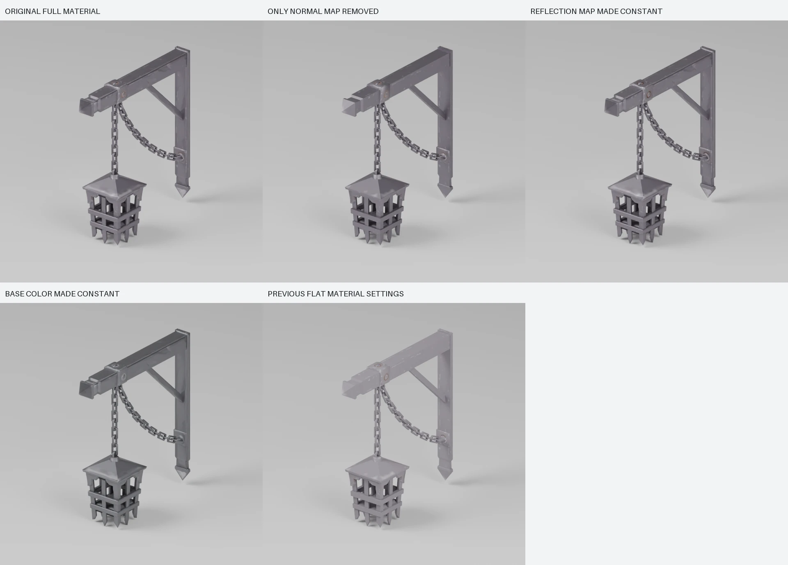
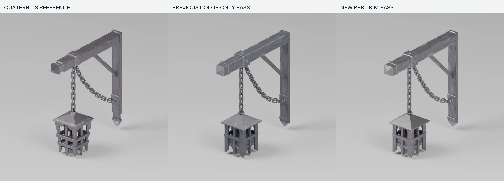
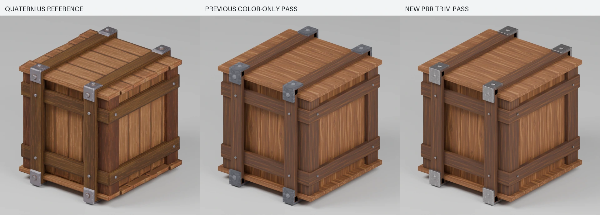

# Material iteration: shiny metal edges

30 October 2026. Follow-up to the first two-prop reconstruction. No production game code/assets were changed.

## What the originals use

The actual `MI_Trim_Metal` export has base-color, tangent normal and metallic/roughness textures, all 512x512. Scalar metallic/roughness factors are 1, multiplying the maps. The normal atlas contains rounded borders, dents, collars and rivets; color also contains pale worn edges. Green in the packed reflection map controls roughness and blue metallic. No occlusion map is connected, so red is unused by this export.

The first reconstruction's metalness 0.05 and constant roughness 0.78 were an inappropriate simplification. It had neither normal nor reflection texture data.

The original becomes visibly flatter when only its normal map is removed. Keeping the painted color but dropping the normal/reflection behavior reproduces much of the earlier chalky result. This demonstrates delivered material behavior; the original artist's exact historical software/workflow is not known from the GLB.

## What changed

Our own rounded canonical slabs are baked onto low-detail UV planes. The resulting shared trim set has:

- **Color:** the retained ImageGen artwork plus edge-aware worn color. No directional illumination is baked into it.
- **Tangent normals:** rounded perimeter shading and restrained surface bump, baked in Blender with +X/+Y/+Z convention.
- **Metallic/roughness:** strongly metallic iron, smoother exposed edges, rougher central paint and non-metallic wood. Red is neutral 1, not a claimed AO bake.

The model's metal UVs now align with these surface bands; small rivets and real bevel faces sample a flatter lighter area. Both props reuse the same three image payloads. No new geometry was added and no Quaternius texture is used in either final reconstruction.

The unlit reference top-metal region averaged approximately sRGB [131.8,124.8,134.1], while our earlier body strip averaged [105.3,105.0,115.0]. Surface color is calibrated in linear space, retaining identical camera/light/exposure for comparison. These calibration factors belong to this atlas, not every future asset.

Detail crops from the same actual renders: [lantern](lantern-metal-detail.webp), [crate](crate-metal-detail.webp). Crops do not add or paint highlights.

A second key-light azimuth checks the reflection response with fixed geometry/camera: [lantern light sweep](lantern-light-sweep.webp), [crate light sweep](crate-light-sweep.webp). Both reference and reconstruction are compared under each light direction. Fine wear patterns, cap details and the lantern's contours still differ; this is a closer finish, not an exact-match certificate.

## Cost and verification

| Asset   | Reference bytes | New PBR bytes | Triangles, unchanged from previous reconstruction |
| ------- | --------------: | ------------: | ------------------------------------------------: |
| Lantern |         176,332 |       141,256 |                                             2,490 |
| Crate   |         161,276 |       126,976 |                                             1,552 |

Each export uses three 512x512 images. This matches the lantern reference's texture count and is lower than the crate reference's six. It is more shader/texture work than the former one-map simplification, so no frame-rate equivalence to that simplification is claimed.

Normal and packed data use lossless WebP; decoded pixels are compared to their PNG input. Color uses quality-90 WebP. Additional map data initially exceeded the byte budget; optional Meshopt encoding recovered it without changing decoded attributes, winding or image payloads after the separately documented 16-bit quantization. Both final assets pass resource, dimension and source-surface-channel gates and were re-imported/rendered from their actual GLBs.

The previous color-only lantern now fails the new surface requirements even though its geometry/byte budgets pass; see `before/lantern/surface-validation.json`.

## Mistakes captured in the skill

1. A successful first bake still sampled the primitive cube's old render UV, turning every color strip into timber. Explicitly reusing the intended active render UV fixed it. `failed-uv-bake/trim-base-color.png` retains that failure.
2. Treating a normal/packed data map like a color image risked changing the signal. Data compression is now pixel-preserving and verified separately.
3. Sampling a generic stain image without edge-aligned UVs cannot reproduce an edge-aware trim. The surface layout and mapping must be designed together.
4. Passing only file-size/triangle gates accepted an incomplete material system. Reference map roles are now an optional validator input, used by the two-prop reproduction workflow.

## Runtime caveat found in current release code

`apps/web/src/assets.tsx` caps the imported metalness factor at 0.15. Normal textures remain connected in normal textured mode. Its roughness clamp applies to the scalar factor, not a per-pixel minimum. The inspected world-lighting files do not assign a global reflection environment; the boat uses its own cached PMREM gradient.

A future in-game integration needs a targeted surface profile and appropriate shared reflections under actual day/night lighting. The current task does not remove the clamp globally or change the world. The standalone studio viewer now supplies a procedural room reflection environment for both comparison scenes; its browser behavior remains unverified because the app blocks local file URLs.

## Reproduction

`experiments/asset-skill-lab/reproduce.sh` rebuilds the bake, props, exports and normal matched-view evidence without new ImageGen calls. The material ablation uses `material-study/ablate.mjs`, followed by `inspect_asset.py --views three-quarter` for each resulting variant with the reference framing. Light-sweep renders use the same framing with `--key-angle 90`.

After those renders, run `python3 experiments/asset-skill-lab/material-study/build_evidence.py` to compose the unchanged-render comparison sheets. The reproducible surface workflow is in `.agents/skills/la-baraj-3d-assets/references/surfaces.md`.
